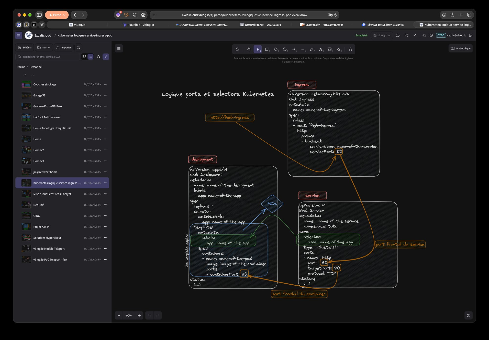

# Excalicloud

Excalidraw auto-hébergé avec un **gestionnaire de fichiers intégré** : arborescence de dossiers, **vignettes des schémas**, création, renommage, **sélection et déplacement multiples** (glisser-déposer ou dialogue « Déplacer vers… »), duplication, suppression (corbeille), **recherche plein texte** (noms et contenu des schémas), **tags**, **espace personnel et favoris par utilisateur**, **partage en lecture seule par lien signé**, import/export de fichiers `.excalidraw`, sauvegarde automatique côté serveur, **historique des versions** avec comparaison visuelle et restauration, **serveur MCP** pour que Claude lise et crée des schémas (jetons d'API personnels et OAuth). Interface web unique, responsive (l'explorateur devient un tiroir sur mobile).

- **Backend** : Go 1.24, bibliothèque standard uniquement (aucune dépendance externe), API REST/JSON, stockage en fichiers `.excalidraw` sur un volume.
- **Frontend** : React 19 + composant officiel [`@excalidraw/excalidraw`](https://www.npmjs.com/package/@excalidraw/excalidraw) 0.18.1 (licence MIT), build Vite **embarqué dans le binaire Go** (`embed`).
- **Image** : multi-stage, finale en `distroless/static:nonroot` (~53 Mo), un seul conteneur, aucun accès Internet requis à l'exécution (polices Excalidraw servies localement).

> Projet indépendant, non affilié à Excalidraw ni approuvé par Excalidraw s.r.o. ; il utilise le composant open source `@excalidraw/excalidraw` (MIT). Voir [Licence](#licence--license).
> *Independent project, not affiliated with or endorsed by Excalidraw; it uses the open source `@excalidraw/excalidraw` component (MIT). See [License](#licence--license).*

## Exemple visuel de fonctionnement

Explorateur (espace personnel, vignettes) à gauche, schéma ouvert dans l'éditeur Excalidraw à droite, en thème sombre et authentification OIDC.



## Architecture

```
Navigateur ──HTTP──▶ conteneur excalicloud (:8080, uid 65532, rootfs read-only)
                       ├─ /            SPA React + Excalidraw (embarquée dans le binaire)
                       ├─ /api/...     API fichiers (Go net/http)
                       ├─ /s/<jeton>   schéma partagé en lecture seule (hors authentification)
                       ├─ /auth/...    connexion OIDC (AUTH_MODE=oidc)
                       ├─ /mcp         serveur MCP (jeton Bearer requis)
                       ├─ /oauth/...   autorisation OAuth des clients MCP (claude.ai, Claude Desktop)
                       └─ /healthz     sonde
                              │
                              ▼
                       volume /data
                         ├─ projets/réseau/sdn.excalidraw   ← fichiers JSON Excalidraw standards
                         ├─ .library.excalidrawlib          ← bibliothèque partagée
                         ├─ .settings.json, .logo.png       ← titre et logo de la barre
                         ├─ .thumbs/projets/réseau/sdn.excalidraw.png ← miniatures (régénérables)
                         ├─ .meta.json                       ← tags, icônes, auteurs (et anciens favoris communs)
                         ├─ .users/<id>/home/...             ← espace personnel (même structure : .history, .thumbs, .trash…)
                         ├─ .users/<id>/favoris/x.excalidraw → ../../../projets/x.excalidraw ← favoris (liens symboliques)
                         ├─ .shares.json, .share-secret      ← liens de partage et clé de signature
                         ├─ .session-secret                  ← clé des sessions OIDC (si SESSION_SECRET vide)
                         ├─ .tokens.json                     ← jetons d'API et autorisations OAuth (hachés SHA-256), clé HMAC
                         ├─ .history/projets/réseau/sdn.excalidraw/<date>.excalidraw ← versions
                         └─ .trash/<horodatage>/...         ← éléments supprimés
```

Les schémas restent des fichiers `.excalidraw` standards : ils s'ouvrent tels quels dans excalidraw.com, VS Code (extension Excalidraw) ou Obsidian, et se sauvegardent/versionnent comme n'importe quel répertoire (rsync, restic, git...).

## Démarrage

```bash
cp .env.example .env        # optionnel : port, authentification (Basic ou OIDC)
docker compose up -d --build
# http://localhost:8080
```

| Variable        | Défaut   | Rôle                                                              |
|-----------------|----------|-------------------------------------------------------------------|
| `LISTEN_ADDR`   | `:8080`  | Adresse d'écoute                                                  |
| `DATA_DIR`      | `/data`  | Racine des schémas                                                |
| `MAX_BODY_MB`   | `50`     | Taille max d'un schéma (images embarquées en base64 comprises)    |
| `AUTH_MODE`     | `local`  | `local` ou `oidc` (voir *Authentification*) |
| `AUTH_USER` / `AUTH_PASSWORD` | vide | Mode `local` : authentification HTTP Basic si les deux sont définis, aucune sinon |
| `OIDC_*`, `SESSION_*` | | Mode `oidc` : voir *Authentification* |
| `UPDATE_CHECK`  | `true`   | Interroge `registry.npmjs.org` pour signaler une nouvelle version d'Excalidraw (`false` : désactivé) |
| `UPDATE_CHECK_INTERVAL` | `12h` | Intervalle entre deux vérifications (durée Go, minimum `1m`) |
| `NPM_REGISTRY`  | `https://registry.npmjs.org` | Registre interrogé (miroir interne possible) |
| `HISTORY_KEEP`  | `50`     | Versions conservées par schéma (`0` : historique désactivé) |
| `HISTORY_INTERVAL` | `10m` | Écart minimal entre deux versions automatiques (`0` : une version à chaque enregistrement) |
| `HISTORY_MAX_AGE` | `0`    | Âge au-delà duquel une version est purgée (ex. `2160h` = 90 jours ; `0` : jamais) |
| `SHARE_SECRET`  | vide     | Clé de signature des liens de partage (16 caractères min.) ; vide : clé aléatoire générée dans `DATA_DIR/.share-secret` |
| `EXCALIDRAW_VERSION` (build) | vide | Version d'Excalidraw imposée à la construction de l'image ; vide = celle de `package-lock.json` |

Bind mount au lieu du volume nommé : `- ./data:/data` puis `chown -R 65532:65532 ./data`.

## Authentification

`AUTH_MODE` choisit le mode :

| Mode | Comportement |
|---|---|
| `local` (défaut) | Authentification HTTP Basic si `AUTH_USER` et `AUTH_PASSWORD` sont définis ; sinon aucune (usage local, ou reverse proxy qui authentifie déjà). Comportement des versions précédentes. |
| `oidc` | Connexion auprès d'un fournisseur OpenID Connect (Authentik, Keycloak, Entra ID, Google, Dex…), flux *Authorization Code* + PKCE (S256). |

Dans les deux modes, `/s/…` (liens de partage), `/api/public/…`, `/healthz` et les fichiers statiques du build restent accessibles sans authentification.

### Variables du mode `oidc`

| Variable | Défaut | Rôle |
|---|---|---|
| `OIDC_ISSUER` | requis | URL de l'émetteur ; `<OIDC_ISSUER>/.well-known/openid-configuration` doit répondre depuis le conteneur |
| `OIDC_CLIENT_ID` | requis | Identifiant du client |
| `OIDC_CLIENT_SECRET` | vide | Secret d'un client confidentiel (`client_secret_basic`) ; vide : client public, PKCE seul. `OIDC_CLIENT_SECRET_FILE` lit le secret dans un fichier (secret Docker) |
| `OIDC_REDIRECT_URL` | vide | URI de retour, ex. `https://draw.example.org/auth/callback` ; vide : déduite de la requête (`X-Forwarded-Proto` / `X-Forwarded-Host` du reverse proxy). La fixer est recommandé |
| `OIDC_SCOPES` | `openid profile email` | Scopes demandés (espaces ou virgules) |
| `OIDC_ALLOWED_GROUPS` | vide | Groupes autorisés, séparés par des virgules ; vide : tout compte authentifié par le fournisseur |
| `OIDC_GROUPS_CLAIM` | `groups` | Claim de l'ID Token portant les groupes ; chemin pointé accepté (`realm_access.roles`) |
| `OIDC_LOGOUT` | `true` | La déconnexion ferme aussi la session chez le fournisseur (`end_session_endpoint`) |
| `SESSION_TTL` | `24h` | Durée de session, prolongée à chaque requête passée la moitié : elle n'expire qu'après une inactivité de cet ordre (minimum `5m`) |
| `SESSION_SECRET` | vide | Clé de signature des cookies (16 caractères min.) ; vide : clé aléatoire générée dans `DATA_DIR/.session-secret` |

Fonctionnement :

- Sans session, une page renvoie vers `/auth/login` et l'API répond `401` (en-tête `X-Auth-Login`, que l'interface suit). `/auth/login` redirige vers le fournisseur avec `state`, `nonce` et le défi PKCE ; au retour (`/auth/callback`), le code est échangé contre l'ID Token, dont sont vérifiés la signature (RS\*, PS\*, ES\* via le JWKS, rotation des clés comprise ; HS\* avec le secret client), l'émetteur, l'audience, l'expiration et le nonce. L'utilisateur revient sur l'URL demandée, schéma ouvert compris (`#/dossier/schema.excalidraw`).
- La session tient dans un cookie `HttpOnly`, `SameSite=Lax`, `Secure` en HTTPS, signé HMAC-SHA256. Il ne contient que l'identité (aucun jeton du fournisseur) et survit aux redémarrages du conteneur ; changer `SESSION_SECRET` (ou supprimer `.session-secret`) déconnecte tout le monde.
- À droite de la barre du haut, un cartouche encadré **OIDC** suivi de l'e-mail de l'utilisateur, puis l'icône de déconnexion (nom et e-mail au survol) : elle enregistre le schéma ouvert, puis déconnecte. En mode local, le cartouche est **LOCAL** suivi du nom du compte Basic (ou de `local` sans authentification).
- Un compte hors de `OIDC_ALLOWED_GROUPS` reçoit une page *Accès refusé*.
- L'arborescence commune est partagée par tous ; chaque utilisateur a en plus son espace **Personnel** et ses **Favoris** (voir *Espaces personnels et favoris*), identifiés par l'e-mail de l'ID Token (à défaut le `sub`).
- Implémentation en bibliothèque standard Go (`internal/auth`), sans dépendance ajoutée.

#### Exemple Authentik

1. *Applications → Providers → Create → OAuth2/OpenID Provider* : type de client *Confidential*, *Redirect URIs* `https://draw.example.org/auth/callback` ; clé de signature : un certificat (RS256), ou aucune (HS256 avec le secret client, accepté aussi).
2. *Applications → Create* : slug `excalicloud`, provider ci-dessus. Restreindre l'accès par les *bindings* de l'application, ou par `OIDC_ALLOWED_GROUPS` (le scope `profile` d'Authentik inclut le claim `groups`).
3. `.env` :

```bash
AUTH_MODE=oidc
OIDC_ISSUER=https://auth.example.org/application/o/excalicloud/
OIDC_CLIENT_ID=<Client ID>
OIDC_CLIENT_SECRET=<Client Secret>
OIDC_REDIRECT_URL=https://draw.example.org/auth/callback
```

#### Exemple Keycloak

1. *Clients → Create client* : OpenID Connect, *Client ID* `excalicloud`, *Client authentication* activé, *Standard flow* seul ; *Valid redirect URIs* `https://draw.example.org/auth/callback`, *Valid post logout redirect URIs* `https://draw.example.org/auth/logged-out` ; onglet *Advanced* : *Proof Key for Code Exchange Code Challenge Method* = `S256`.
2. Groupes : *Clients → excalicloud → Client scopes → excalicloud-dedicated → Add mapper → By configuration → Group Membership*, *Token Claim Name* `groups`, *Add to ID token* activé (avec *Full group path*, le `/` initial est ignoré à la comparaison). Pour filtrer sur des rôles de realm : `OIDC_GROUPS_CLAIM=realm_access.roles`, en activant *Add to ID token* sur le mapper *realm roles*.
3. `.env` :

```bash
AUTH_MODE=oidc
OIDC_ISSUER=https://sso.example.org/realms/vlab
OIDC_CLIENT_ID=excalicloud
OIDC_CLIENT_SECRET=<Credentials → Client Secret>
OIDC_REDIRECT_URL=https://draw.example.org/auth/callback
OIDC_ALLOWED_GROUPS=excalicloud-users
```

Sans `id_token_hint`, Keycloak demande de confirmer la déconnexion ; `OIDC_LOGOUT=false` limite la déconnexion à excalicloud (la session SSO reste ouverte et la reconnexion est alors immédiate).

## Utilisation

- **＋ Schéma / ＋ Dossier** : création dans le dossier courant.
- **Vignettes / liste / Galerie** : sélecteur à droite de la recherche (choix mémorisé par navigateur). Le tri (nom, date de modification, taille) se choisit à droite du fil d'Ariane (au-dessus des tuiles en Galerie).
- **Galerie** : l'explorateur couvre toute la zone de travail, comme une page d'accueil. Dossiers (dont `..`, Favoris, Personnel, Poubelle) et schémas s'affichent en tuiles de même taille : grande icône et contenu (nombre de schémas et de sous-dossiers) pour un dossier ; pour un schéma, miniature, nom complet, date relative et dernier auteur, taille, nombre de versions et de liens de partage actifs, nombre d'éléments, textes, flèches, images et cadres, tags. Ouvrir un schéma referme la galerie (☰ ou `Échap` pour y revenir). Le bouton ⓘ d'une tuile (ou *Détails* dans son menu) ouvre le **panneau Détails** : création (date et auteur), dimensions du canevas, couleur de fond, noms des cadres, dernières versions et liens de partage avec leur expiration.
- **⋯** sur un élément : renommer, déplacer, dupliquer, télécharger, supprimer.
- **Sélection multiple** : case à cocher (au survol, toujours visible sur écran tactile), `Ctrl/Cmd+clic`, `Maj+clic` pour une plage, `Ctrl+A` pour tout. Tant qu'une sélection est en cours, un simple clic/tap ajoute ou retire un élément. La barre de sélection propose *Déplacer…* et la mise à la corbeille ; `Échap` annule, `Suppr` supprime.
- **Déplacer** : glisser-déposer (souris) d'un élément — ou de toute la sélection — sur un dossier, sur `..` ou sur le fil d'Ariane ; ou *Déplacer…* qui ouvre un sélecteur de dossier (navigation, création de dossier), utilisable au doigt. En cas de conflit de nom dans la destination, les autres éléments sont tout de même déplacés et les échecs listés.
- **Importer** : envoie un ou plusieurs `.excalidraw` locaux dans le dossier courant. Le bouton voisin importe un **dossier complet**.
- **Glisser-déposer depuis le poste** : des fichiers ou des dossiers entiers déposés sur l'explorateur sont importés dans le dossier courant (ou dans le dossier survolé). L'arborescence est recréée, seuls les `.excalidraw` sont importés, les fichiers et dossiers cachés (`.git`, `.DS_Store`) sont ignorés et un schéma déjà présent n'est jamais écrasé. Un bilan s'affiche (détail au survol).
- **Sauvegarde** : automatique 1,5 s après la dernière modification, immédiate avec `Ctrl/Cmd+S`. Le statut (Modifié / Enregistrement… / Enregistré) est affiché dans la barre du haut.
- **Lien direct** : l'URL `http://hôte:8080/#/dossier/schema.excalidraw` ouvre le schéma.
- **Bibliothèque** Excalidraw : persistée côté serveur, partagée entre tous les schémas.
- **Largeur de l'explorateur** (bureau) : glisser la poignée entre l'explorateur et le canevas ; flèches ←/→ au clavier quand elle a le focus (Maj : pas plus grand), double-clic pour revenir à 330 px. Mémorisée par navigateur.
- **Explorateur épinglé ou flottant** (bureau) : la punaise à droite de la recherche bascule entre panneau fixe à côté du schéma (par défaut) et panneau masqué, qui s'ouvre par-dessus le schéma avec le bouton ☰ ou en survolant le bord gauche de la fenêtre. Il se referme à l'ouverture d'un schéma, au clic à côté, avec `Échap`, ou dès que le pointeur le quitte s'il a été ouvert par survol. À la bascule, le schéma reste en place à l'écran. Choix mémorisé par navigateur ; sur mobile, l'explorateur reste un tiroir.
- **Style** : l'explorateur et la barre du haut reprennent les couleurs, la police, les rayons et les tailles de boutons d'Excalidraw (jetons `--ex-*` en tête de `styles.css`), en clair comme en sombre.
- **Mise à jour d'Excalidraw** : quand la version publiée sur le canal choisi (voir *Paramètres*) diffère de celle embarquée, une icône apparaît à droite de la barre du haut ; un clic ouvre les paramètres sur la commande de reconstruction (voir *Mettre à jour Excalidraw*).
- **Mode clair/sombre** : bouton ☀/☾ à droite de la barre du haut ; s'applique à l'interface et au canevas Excalidraw, reste synchronisé avec le choix du menu d'Excalidraw. Mémorisé par navigateur.
- **Barre du haut** : le logo renvoie vers https://vblog.io (nouvel onglet ; titre affiché à défaut de logo). À sa droite, le chemin de l'emplacement courant (dossier de l'explorateur, ou dossier et nom du schéma ouvert) : un clic sur un niveau affiche ce dossier en Galerie à la place du schéma. Le schéma est d'abord enregistré, puis fermé ; s'il n'a pas pu être enregistré, il reste ouvert sous la Galerie.
- **Paramètres** : bouton ⚙ à droite de la barre. Section *Apparence* : titre et logo. Section *Excalidraw* : canal suivi, *Stable* (`latest`) ou *Préversion* (`next`), versions publiées et commande de reconstruction. Les paramètres sont stockés dans `DATA_DIR/.settings.json`.
- **Titre et logo** : communs à tous les utilisateurs. Le logo (PNG, 5 Mo max) est recadré au centre, réduit à 64×64 px côté serveur et affiché dans un masque rond (34 px dans la barre, net sur écran HiDPI ; taille réglable via `--logo-size` dans `styles.css`).

### Mettre à jour Excalidraw

La version d'Excalidraw est figée au build (`frontend/package-lock.json`). Le serveur lit les dist-tags du paquet sur le registre npm (`/api/update`, toutes les 12 h par défaut) et l'interface compare la version du canal choisi dans les paramètres à celle embarquée :

- `latest` : versions stables (0.18.1 au 2026-10-07) ;
- `next` : préversion publiée à chaque modification de la branche principale d'Excalidraw (ex. `0.18.0-4f68076`). Son numéro est inférieur à la dernière stable alors que le code est plus récent : l'icône compare donc les versions par égalité, ce qui propose aussi le retour de `next` à `latest`.

Changer de canal dans l'interface ne change rien tant que l'image n'est pas reconstruite. Pour reconstruire avec la version indiquée :

```bash
EXCALIDRAW_VERSION=0.18.2 docker compose up -d --build   # ou EXCALIDRAW_VERSION=… dans .env
```

Les versions `0.x` d'Excalidraw peuvent contenir des changements incompatibles : tester l'image avant de la mettre en service. Pour figer durablement la nouvelle version dans le dépôt : `cd frontend && npm install --save-exact @excalidraw/excalidraw@0.18.2`, puis commiter `package.json` et `package-lock.json`. Sans accès Internet, aucune icône n'est affichée.

### Miniatures

Rendues par le navigateur avec `exportToBlob` d'Excalidraw (PNG 640 px au plus grand côté), puis stockées dans `DATA_DIR/.thumbs/` :

- à chaque sauvegarde du schéma ouvert ;
- à la demande pour les schémas sans miniature ou modifiés hors de l'application (import, copie de fichiers sur le volume, script) : l'explorateur charge le schéma, génère la vignette (2 en parallèle, seulement pour les éléments visibles) et l'envoie au serveur, une fois pour toutes.

Une miniature plus ancienne que son schéma est ignorée (`404`) puis régénérée. La Galerie régénère aussi une miniature rendue à l'ancienne taille (320 px) quand elle est trop petite pour la scène. Elles suivent les renommages, déplacements, copies et suppressions ; `.thumbs/` peut être supprimé sans risque. En thème sombre, elles sont inversées en CSS comme le canevas Excalidraw.

### Recherche

Le champ de recherche de l'explorateur cherche dans les noms de fichiers et de dossiers **et dans le contenu des schémas** : textes, libellés des formes et des flèches, noms des cadres, liens. Taper `172.27.207` retrouve tous les schémas qui mentionnent ce réseau, avec l'extrait correspondant sous le nom. Tous les mots saisis doivent être présents (dans le nom ou le contenu) ; casse et accents sont ignorés (`replication` trouve « Réplication »).

L'index est tenu en mémoire par le serveur : le texte de chaque schéma est extrait à la première recherche, puis relu seulement si le fichier a changé (date ou taille), y compris pour les fichiers modifiés hors de l'application. Rien n'est écrit sur le volume.

### Espaces personnels et favoris

En tête de la racine de l'explorateur, deux entrées propres à l'utilisateur connecté :

- **Personnel** : espace privé, invisible des autres utilisateurs (liste, recherche, tags, API). Il fonctionne comme l'arborescence commune (dossiers, historique, miniatures, corbeille, partage par lien) ; on y déplace des schémas par glisser-déposer ou *Déplacer…*, dans les deux sens, avec leur historique, leurs tags et leurs liens de partage. Stockage : `DATA_DIR/.users/<id>/home/`, créé à la première connexion.
- **Favoris** : l'étoile (menu « … » ou barre de sélection) ou un glisser-déposer sur *Favoris* crée un **lien symbolique relatif** vers le schéma d'origine dans `DATA_DIR/.users/<id>/favoris/`, sans le déplacer. Ouvrir un favori ouvre l'original ; *Supprimer* depuis Favoris retire seulement le lien. Les liens suivent les renommages et déplacements de l'original (pour tous les utilisateurs) et disparaissent quand il est supprimé ; un lien cassé par une modification hors de l'application est barré et peut être retiré. Seuls les schémas peuvent être favoris, pas les dossiers.

`<id>` = e-mail OIDC en minuscules (caractères hors `[a-z0-9._@+-]` remplacés par `_`) ; en mode `local`, un seul utilisateur `local`, quel que soit le compte Basic. À la création d'un espace, les favoris communs de l'ancienne version (`.meta.json`) sont repris une fois dans les Favoris de l'utilisateur.

Le volume doit accepter les liens symboliques (ext4, xfs, btrfs, ZFS, NFS ; pas certains montages CIFS/SMB).

### Tags

Menu « … » d'un élément (ou barre de sélection pour plusieurs) : **Tags…**. Les tags sont libres (40 caractères, 20 par élément, saisis séparés par des virgules), comparés sans casse ni accents ; un tag déjà utilisé garde son écriture d'origine (`nsx` devient `NSX` s'il existe). La ligne de filtres sous la recherche liste les tags utilisés avec leur nombre d'éléments : un clic sur un tag affiche les éléments correspondants de toute l'arborescence (et de l'espace personnel), combinables avec le texte recherché. Les tags participent aussi à la recherche texte.

Stockage : `DATA_DIR/.meta.json` (`{"items":{"chemin":{"tags":[…]}}}`, et `.meta.json` de chaque espace personnel), mis à jour aux renommages, déplacements, copies (tags seuls) et suppressions. Le même fichier retient pour chaque schéma son créateur et sa date de création (`createdBy`, `created`, pour les schémas créés à partir de cette version) et le dernier utilisateur qui l'a enregistré (`editedBy`, réécrit seulement quand il change). En mode `local` l'utilisateur est toujours `local` et n'est pas affiché.

### Partage en lecture seule

Icône de partage de la barre du haut (schéma ouvert) ou menu « … » → **Partager…** : crée un lien `https://<hôte>/s/<jeton>` valable 1, 7 ou 30 jours, ou sans expiration, copié dans le presse-papiers. Le destinataire voit le schéma dans Excalidraw en mode lecture (zoom, déplacement, export PNG/SVG, téléchargement du `.excalidraw`), **sans authentification**, dans sa dernière version enregistrée ; il n'a accès à rien d'autre (ni explorateur, ni API).

- Jeton = `<id>.<signature>` : id aléatoire de 128 bits et HMAC-SHA256 tronqué (128 bits) par la clé du serveur. Un jeton n'est accepté que si la signature est valide, si le lien existe encore dans `DATA_DIR/.shares.json` et s'il n'a pas expiré.
- **Révocation** lien par lien (dialogue *Partager* ou *Paramètres → Liens de partage*), ou globale avec **Tout révoquer**, qui renouvelle aussi la clé (sauf si elle est imposée par `SHARE_SECRET`).
- Le lien suit le schéma s'il est renommé ou déplacé, et disparaît s'il est supprimé.
- Avec l'authentification intégrée (Basic ou OIDC), seuls `/s/…`, `/api/public/…`, `/healthz` et les fichiers statiques du build (code de l'application, polices) échappent à l'authentification. Derrière un reverse proxy avec SSO, exclure de la même façon `/s/` et `/api/public/` de l'authentification du proxy. Réponses en `X-Robots-Tag: noindex`.

### Historique des versions

Avant qu'un schéma soit écrasé, son contenu précédent est copié dans `DATA_DIR/.history/<chemin du schéma>/<date>.excalidraw` (fichier Excalidraw complet, ouvrable tel quel). L'enregistrement automatique écrit toutes les 1,5 s pendant l'édition : une version n'est donc conservée que si la précédente date d'au moins `HISTORY_INTERVAL` (10 min par défaut), ce qui donne une version par séance de travail ou par tranche de 10 minutes. Les `HISTORY_KEEP` plus récentes sont gardées, et `HISTORY_MAX_AGE` purge les plus anciennes.

Le dialogue *Historique* (icône horloge de la barre du haut, ou menu « … » d'un schéma dans l'explorateur) :

- liste les versions et affiche un aperçu de chacune ;
- **Différences** : l'état actuel superposé à la version choisie, éléments ajoutés depuis en vert, supprimés depuis en rouge pointillé, modifiés en orange, le reste estompé (comparaison par identifiant d'élément Excalidraw) ;
- **Restaurer** remplace le schéma par la version ; l'état remplacé devient lui-même une version, la restauration s'annule donc ;
- **Restaurer en copie** crée un nouveau schéma « nom (version du …) » à côté de l'original ;
- **Créer une version** fixe immédiatement l'état actuel (jalon avant une modification importante).

L'historique suit les renommages et déplacements ; à la suppression d'un schéma, il part avec lui dans la corbeille (`.trash/<horodatage>/.history/`). Pas de binaire `git` requis : l'image reste distroless.

### Concurrence

Chaque lecture renvoie un `ETag` (SHA-256 tronqué du contenu) ; chaque sauvegarde l'envoie en `If-Match`. Si le fichier a été modifié ailleurs (autre onglet, autre poste), le serveur répond `412` et l'interface propose d'écraser ou de recharger. Il n'y a pas d'édition collaborative temps réel (voir *Évolutions*).

## Accès MCP (Claude) et jetons d'API

Le serveur expose un [serveur MCP](https://modelcontextprotocol.io) sur `https://<hôte>/mcp` (transport *Streamable HTTP*, réponses JSON) : Claude peut lister, rechercher, lire, créer ou remplacer des schémas et créer des dossiers, avec les droits de l'utilisateur qui l'a autorisé (arborescence commune, son `.perso`, ses favoris).

| Outil | Rôle |
|---|---|
| `list_diagrams` | contenu d'un dossier (`recursive` : sous-dossiers, 500 entrées max) |
| `search_diagrams` | recherche plein texte (noms, tags, texte), filtres tag et favoris |
| `read_diagram` | éléments et `appState` d'un schéma (images embarquées omises par défaut) |
| `write_diagram` | création, ou remplacement avec `overwrite: true` (version précédente conservée dans l'historique) ; renvoie le lien du schéma |
| `create_folder` | création d'un dossier (et de ses parents) |

`write_diagram` complète les éléments incomplets (id, seed, couleurs…) et accepte deux raccourcis de l'API *skeleton* d'Excalidraw : `"label": {"text": "…"}` sur une forme ou une flèche (texte lié, forme agrandie si le texte ne tient pas), et `"start"/"end": {"id": "…"}` sur une flèche (liaison aux formes, tracé calculé de bord à bord). Aucun outil ne supprime ni ne déplace.

Chaque requête vers `/mcp` doit porter `Authorization: Bearer <jeton>`. Deux façons d'obtenir un jeton, gérées dans **Paramètres › Accès API et MCP** (liste, date de dernière utilisation, révocation) :

- **Connecteur claude.ai, Claude Desktop, Claude mobile** : ces clients ne savent pas envoyer de jeton fixe (sauf en-têtes de requête, en bêta pour certaines organisations) ; ils utilisent OAuth. excalicloud embarque un petit serveur d'autorisation OAuth 2.1 (enregistrement dynamique RFC 7591, PKCE S256, rotation des jetons de rafraîchissement) adossé à la connexion existante (OIDC ou Basic) : *Paramètres › Connecteurs › Ajouter un connecteur personnalisé*, URL `https://<hôte>/mcp`, champs OAuth vides. Claude ouvre la page de connexion d'excalicloud puis une page de consentement ; l'accès apparaît ensuite dans la liste (« Connecteur autorisé (claude.ai) »). Jeton d'accès valable 1 h, autorisation expirée après 90 jours sans usage.
- **Claude Code, scripts** : créer un **jeton personnel** (affiché une seule fois, sans expiration, révocable), puis :

```bash
claude mcp add --transport http excalicloud https://<hôte>/mcp \
  --header "Authorization: Bearer exc_…"
```

Les jetons personnels valent aussi pour l'API REST (`curl -H "Authorization: Bearer exc_…" https://<hôte>/api/list`), sauf la gestion des jetons, réservée à la session de l'interface. Claude Code peut aussi passer par OAuth (`claude mcp add --transport http excalicloud https://<hôte>/mcp` sans en-tête, puis `/mcp` pour s'authentifier).

Conditions côté exploitation :

- `PUBLIC_URL` (ou à défaut l'origine de `OIDC_REDIRECT_URL`) doit être l'URL publique exacte : elle forme l'identifiant de ressource OAuth `<PUBLIC_URL>/mcp`. Vide, elle est déduite de `X-Forwarded-Proto`/`X-Forwarded-Host`.
- Les connecteurs claude.ai/Desktop appellent le serveur **depuis l'infrastructure d'Anthropic** (plage `160.79.104.0/21`) : `/mcp`, `/.well-known/oauth-*` et `/oauth/*` doivent être joignables depuis Internet et, derrière un SSO porté par le proxy, exclus de son authentification (`/oauth/authorize` reste protégé par la session d'excalicloud).
- `OAUTH_REDIRECT_HOSTS` (défaut `claude.ai,claude.com`) limite les adresses de retour OAuth en https ; les adresses de bouclage (`http://localhost:<port>`, Claude Code) sont toujours acceptées.

## API

Tous les chemins sont relatifs à `DATA_DIR`, en notation `/`. Les composants commençant par `.` sont refusés, et les liens symboliques sortant de la racine sont bloqués. Deux préfixes virtuels, propres à l'utilisateur de la requête : `.perso/…` (son espace personnel) et `.favoris` (`GET /api/list?path=.favoris` liste ses favoris, `path` = chemin de l'original, `link` = nom du lien ; `DELETE /api/entry?path=.favoris/<lien>` retire le lien). La racine (`path=`) commence par les entrées `{"special":"favoris"}` et `{"special":"perso"}`.

| Méthode | Route | Corps / paramètres | Réponse |
|---|---|---|---|
| GET | `/api/list?path=dir[&details=1]` | | `[Entry]` (dossiers puis schémas) ; `editedBy` = dernier utilisateur à avoir enregistré le schéma ; avec `details=1`, `details` = compteurs (`elements`, `texts`, `arrows`, `images`, `frames`, `frameNames`), emprise `width`×`height`, `background`, `versions`, `shares` actifs, `created`/`createdBy` ; pour un dossier `dirs` et `files` |
| GET | `/api/search?q=texte[&tag=t][&fav=true][&details=1]` | | `[Entry + "snippet"]` (200 max) : noms et tags puis contenu, tous les mots requis ; `q` facultatif avec un filtre |
| GET | `/api/tags` | | `[{"name","count"}]` |
| POST | `/api/meta/favorite` | `{"paths":[…],"favorite":true}` | `204` ; schémas seulement, favoris de l'utilisateur (liens dans `.users/<id>/favoris`) |
| POST | `/api/meta/tags` | `{"paths":[…],"add":["NSX"],"remove":["old"]}` | `204` |
| GET | `/api/file?path=x.excalidraw` | | JSON du schéma + `ETag` |
| PUT | `/api/file?path=x.excalidraw` | JSON ; `If-Match: <etag>` ou `If-None-Match: *` (création) | `Entry` + `ETag` ; `409` existe, `412` conflit |
| POST | `/api/folder` | `{"path":"a/b"}` | `Entry` |
| POST | `/api/move` | `{"from":"a.excalidraw","to":"d/b.excalidraw"}` | `Entry` (renommage / déplacement, fichier ou dossier) |
| POST | `/api/move-many` | `{"paths":["a.excalidraw","dossier"],"dir":"d"}` | `[{"from","to"}\|{"from","error"}]` : déplacement multiple, résultat par élément |
| GET | `/api/thumb?path=x.excalidraw&v=<modTime>` | | PNG ; `404` si absente ou périmée |
| PUT | `/api/thumb?path=x.excalidraw` | PNG (1 Mo max) | `204` |
| POST | `/api/copy` | `{"from":"…","to":"…"}` | `Entry` |
| DELETE | `/api/entry?path=x[&recursive=true]` | | `204` (déplacé dans `.trash/`) |
| GET | `/api/history?path=x.excalidraw` | | `[{"id","time","size"}]`, la plus récente en premier |
| GET | `/api/history/version?path=x.excalidraw&id=<id>` | | JSON de la version |
| POST | `/api/history/snapshot` | `{"path":"x.excalidraw"}` | `{"id","time","size"}` (version du contenu courant) |
| POST | `/api/history/restore` | `{"path":"x.excalidraw","id":"<id>"}` | `Entry` + `ETag` |
| GET | `/api/shares[?path=x.excalidraw]` | | `[{"id","token","path","created","expires"}]` (d'un schéma ou tous) |
| POST | `/api/shares` | `{"path":"x.excalidraw","days":7}` (`0` : sans expiration) | lien créé |
| DELETE | `/api/shares?id=<id>` | | `204` |
| POST | `/api/shares/revoke-all` | | `204` (tous les liens, nouvelle clé) |
| GET | `/api/public/<jeton>` | | `{"name","title","logo","scene"}`, **hors authentification** ; `404` si invalide, expiré ou révoqué |
| GET/PUT | `/api/library` | bibliothèque `excalidrawlib` | |
| GET | `/api/settings` | | `{"title":"...","logo":"<version>","channel":"latest"}` (`logo` vide sans logo) |
| PUT | `/api/settings` | `{"title":"..."}` (80 caractères max, vide = titre par défaut) et/ou `{"channel":"latest"\|"next"}` | réglages |
| GET | `/api/logo?v=<version>` | | PNG 64×64 ; `404` sans logo |
| PUT | `/api/logo` | PNG (5 Mo, 8192×8192 px max) | réglages ; image recadrée et ré-encodée |
| DELETE | `/api/logo` | | réglages |
| GET | `/api/update` | | `{"enabled","tags":{"latest","next"},"latest","checkedAt"}` |
| GET | `/api/tokens` | | `[{"id","name","kind":"api"\|"oauth","client","created","lastUsed"}]` : jetons de l'utilisateur |
| POST | `/api/tokens` | `{"name":"Claude Code"}` | `201`, jeton + `"token"` en clair (seule fois où il est renvoyé) |
| DELETE | `/api/tokens/<id>` | | `204` (jeton ou autorisation OAuth révoqués) |
| POST | `/mcp` | JSON-RPC 2.0 (MCP) + `Authorization: Bearer` | serveur MCP ; `401` + `WWW-Authenticate: Bearer resource_metadata=…` sans jeton |
| GET | `/.well-known/oauth-protected-resource`, `/.well-known/oauth-authorization-server` | | métadonnées OAuth (RFC 9728, RFC 8414), hors authentification |
| POST | `/oauth/register`, `/oauth/token` | | enregistrement dynamique et échange de jetons, hors authentification |
| GET/POST | `/oauth/authorize` | | page de consentement (session requise) |
| GET | `/api/me` | | `{"mode":"none"\|"local"\|"oidc","user":{"sub","name","email"},"logout","id"}` ; `id` : identifiant de l'espace personnel |
| GET | `/auth/login?next=/chemin` | | mode `oidc` : redirection vers le fournisseur |
| GET | `/auth/callback` | | mode `oidc` : retour du fournisseur, ouverture de session |
| GET | `/auth/logout` | | mode `oidc` : fin de session (et chez le fournisseur si `OIDC_LOGOUT`) |
| GET | `/healthz` | | `ok` (hors authentification) |
| GET | `/s/<jeton>` | | vue publique en lecture seule (hors authentification) |

`Entry` = `{"name","path","isDir","size","modTime","tags","favorite","special","link","broken"}` (champs après `modTime` omis s'ils sont vides).

Exemple d'automatisation (génération de schémas par script) :

```bash
curl -X PUT 'http://localhost:8080/api/file?path=auto/inventaire.excalidraw' \
     -H 'If-None-Match: *' --data-binary @inventaire.excalidraw
```

## Développement

```bash
# Terminal 1 : API
go run ./cmd/server                 # DATA_DIR=./data par défaut
# Terminal 2 : frontend avec rechargement à chaud (proxy /api -> :8080)
cd frontend && npm install && npm run dev

# Tests et build complet hors Docker
go test ./...
cd frontend && npm run build && cd .. && go build -o server ./cmd/server
```

Arborescence :

```
cmd/server/main.go          serveur HTTP, SPA embarquée, choix de l'authentification, healthcheck
internal/auth/              OIDC (PKCE, vérification de l'ID Token, JWKS) et sessions signées
internal/storage/           accès disque : sécurité des chemins, écriture atomique, ETag, corbeille, historique
internal/storage/spaces.go  espaces personnels (.perso) et favoris par utilisateur (.favoris, liens symboliques)
internal/storage/details.go détails de la Galerie (compteurs, versions, partages, création, dernier auteur)
internal/api/               routes REST
internal/tokens/            jetons d'API (hachés), authentification Bearer, serveur d'autorisation OAuth 2.1
internal/mcp/               serveur MCP (JSON-RPC, outils, normalisation des éléments Excalidraw)
web/embed.go                embarque web/dist (produit par le build Vite)
frontend/src/App.tsx        éditeur Excalidraw, sauvegarde auto, conflits, bibliothèque
frontend/src/Explorer.tsx   gestionnaire de fichiers (vignettes/liste/galerie, tri, sélection multiple, glisser-déposer)
frontend/src/DetailsPanel.tsx panneau Détails de la Galerie (métadonnées, versions, partages)
frontend/src/MoveDialog.tsx sélecteur de dossier « Déplacer vers… »
frontend/src/Thumb.tsx      vignette chargée à l'affichage, générée si absente
frontend/src/thumbs.ts      rendu PNG des miniatures et file de génération
frontend/src/HistoryDialog.tsx historique : aperçu, différences, restauration
frontend/src/TagsDialog.tsx tags d'un ou plusieurs éléments
frontend/src/ShareDialog.tsx liens de partage d'un schéma
frontend/src/ShareView.tsx  vue publique /s/<jeton> (lecture seule)
frontend/src/UserMenu.tsx   cartouche oidc/local + identifiant, déconnexion (mode OIDC)
frontend/src/ApiAccess.tsx  paramètres : adresse MCP, jetons personnels et connecteurs autorisés
```

## Sécurité

- Conteneur non-root, rootfs en lecture seule, `cap_drop: ALL`, `no-new-privileges`.
- L'authentification Basic (`AUTH_MODE=local`) suffit pour un usage local ; en exposition réseau, utiliser `AUTH_MODE=oidc` derrière un reverse proxy TLS (Traefik, Caddy, nginx), ou un SSO porté par le proxy (Authelia, oauth2-proxy, Authentik outpost) avec `AUTH_MODE=local` et `AUTH_*` vides.
- Écritures atomiques (fichier temporaire + `fsync` + `rename`) : pas de schéma tronqué en cas d'arrêt brutal.
- Liens de partage : seule surface accessible sans authentification ; jetons non énumérables (id 128 bits signé HMAC), révocables, à durée limitée au choix. Un lien donne la dernière version enregistrée du schéma, images embarquées comprises.
- Jetons d'API : 256 bits aléatoires, conservés hachés (SHA-256) dans `.tokens.json` (0600), rattachés à un utilisateur, révocables ; un jeton ne peut pas gérer les jetons. OAuth : client public avec PKCE S256 obligatoire, code à usage unique (5 min), formulaire de consentement signé (HMAC, lié à l'utilisateur), redirections limitées à `OAUTH_REDIRECT_HOSTS` et au bouclage. Le serveur MCP n'offre ni suppression ni déplacement ; un remplacement laisse la version précédente dans l'historique.
- Aucune suppression physique : la purge de `.trash/` est à la charge de l'exploitant (ex. `find /data/.trash -mindepth 1 -maxdepth 1 -mtime +30 -exec rm -rf {} +`).

## Limites et évolutions possibles

- **Collaboration temps réel** : nécessiterait le serveur [excalidraw-room](https://github.com/excalidraw/excalidraw-room) (WebSocket) et la logique de réconciliation (`reconcileElements`) côté client.
- **Espaces personnels en mode `local`** : un seul utilisateur (`local`) ; une identité transmise par le reverse proxy (`X-Forwarded-User`) permettrait un espace par compte sans OIDC.
- Les schémas avec beaucoup d'images embarquées sont volumineux (base64 dans le JSON) ; ajuster `MAX_BODY_MB`.

## Licence / License

**Français.** Le code d'Excalicloud est publié sous licence MIT : voir [`LICENSE`](LICENSE) (texte qui fait foi, en anglais) et sa traduction informative [`LICENSE.fr.md`](LICENSE.fr.md). Ce projet est indépendant : il n'est ni affilié à Excalidraw ou Excalidraw s.r.o., ni approuvé ou soutenu par eux. « Excalidraw » est une marque de son titulaire, citée uniquement pour indiquer la compatibilité. Le projet intègre et redistribue des composants tiers sous leurs propres licences, notamment Excalidraw (MIT), les icônes Tabler (MIT) et les polices fournies avec Excalidraw (SIL Open Font License 1.1, MIT) : la liste complète et les notices figurent dans [`THIRD_PARTY_NOTICES.md`](THIRD_PARTY_NOTICES.md).

**English.** Excalicloud is released under the MIT License: see [`LICENSE`](LICENSE). This is an independent project, not affiliated with, endorsed by or sponsored by Excalidraw or Excalidraw s.r.o. "Excalidraw" is a trademark of its owner, used only to describe compatibility. The project embeds and redistributes third-party components under their own licenses, including Excalidraw (MIT), Tabler Icons (MIT) and the fonts shipped with Excalidraw (SIL Open Font License 1.1, MIT): see [`THIRD_PARTY_NOTICES.md`](THIRD_PARTY_NOTICES.md) for the full list and notices.
